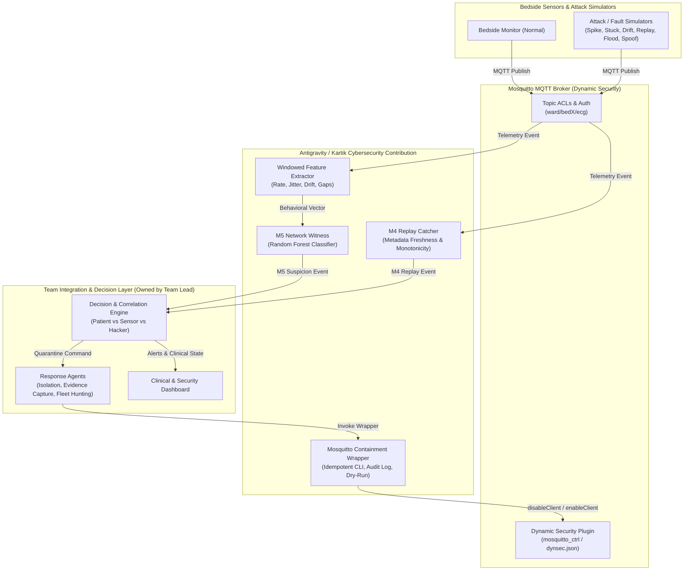

# TessNova System & Security Architecture

**Project:** TessNova — Patient, Sensor, or Hacker?  
**Contribution:** Cybersecurity & Diagnostic Witness Components  
**Deployment Target:** IBM LinuxONE (s390x) & Local Integration Lab  

---

## 1. High-Level System Architecture

TessNova simulates a connected hospital ICU ward where bedside monitors publish clinical telemetry over MQTT. The cybersecurity layer acts as an independent monitoring and witness tier that flags metadata replays and network anomalies, feeding structured evidence to the team's central decision and response agents.



---

## 2. Component Boundaries & Ownership

| Component | Module Lead / Author | Scope & Description |
| :--- | :--- | :--- |
| **Telemetry Contract** | Cybersecurity Lead (Kartik) | Proposed schema (`contracts/telemetry.schema.json`) defining `device_id`, `seq`, `timestamp`, `ecg`. |
| **Attack & Fault Simulators** | Cybersecurity Lead (Kartik) | 8 standalone scripts simulating normal telemetry, sensor faults (`stuck`), and cyber attacks (`spike`, `bias`, `drift`, `replay`, `spoof`, `flood`). |
| **M4 Replay Catcher** | Cybersecurity Lead (Kartik) | Transport-independent sequence and timestamp evaluator. Catches duplicates, stale packets, backward timestamps, and sequence gaps. |
| **M5 Network Witness** | Cybersecurity Lead (Kartik) | Rolling-window behavioral feature extractor and Random Forest classifier. Evaluates traffic rate, timing jitter, and queue drift. |
| **Mosquitto Security & Containment** | Cybersecurity Lead (Kartik) | Defensive wrapper around `mosquitto_ctrl` supporting input sanitization, sub-process argument safety, audit logging, and dry-run execution. |
| **Decision & Correlation Engine (A1/A2)** | Team Integration Lead | Correlates clinical signals (arrhythmias) with cyber signals (M4 replay, M5 flood, ACL drops) to determine: *Patient, Sensor, or Hacker?* |
| **Evidence & Fleet Agents (A3/A4)** | Team Integration Lead | Captures packet traces, queries sibling bedside monitors, and dispatches containment requests. |
| **Hospital Dashboard** | Team Integration Lead | Real-time clinical UI displaying ECG waveforms alongside cybersecurity confidence scores. |
| **LinuxONE Infrastructure** | Team Integration Lead | Host OS configuration, systemd services, Mosquitto broker compilation/deployment on IBM LinuxONE. |

---

## 3. Data Flow & Topic Routing

```
MQTT Topic Hierarchy:
├── ward/
│   └── <device_id>/
│       ├── ecg          (Bedside monitor telemetry: QoS 1)
│       └── commands     (Control/alarm commands: QoS 1)
└── hospital/
    └── security/
        ├── m4_replay    (M4 detection events: JSON)
        ├── m5_witness   (M5 network suspicion events: JSON)
        └── incidents    (Correlated incident events for decision engine)
```

1. **Ingestion:** Bedside monitor publishes to `ward/<device_id>/ecg`.
2. **Security Subscriptions:** `mqtt_replay_listener` subscribes to wildcard `ward/+/ecg`.
3. **M4 Evaluation:** Evaluates sequence monotonicity, age, and duplicates against in-memory per-device state.
4. **M5 Extraction:** Ingests arrival timestamps and payload lengths into rolling 10-packet windows. Computes message rate, inter-arrival variance, and drift.
5. **Event Emission:** Output events formatted according to versioned JSON schemas are published to `hospital/security/*` or piped via internal queues.
6. **Decision Dispatch:** When an anomaly is confirmed, the team's decision layer invokes `containment.isolate_device(device_id)` to disable the offending client in Mosquitto Dynamic Security.
